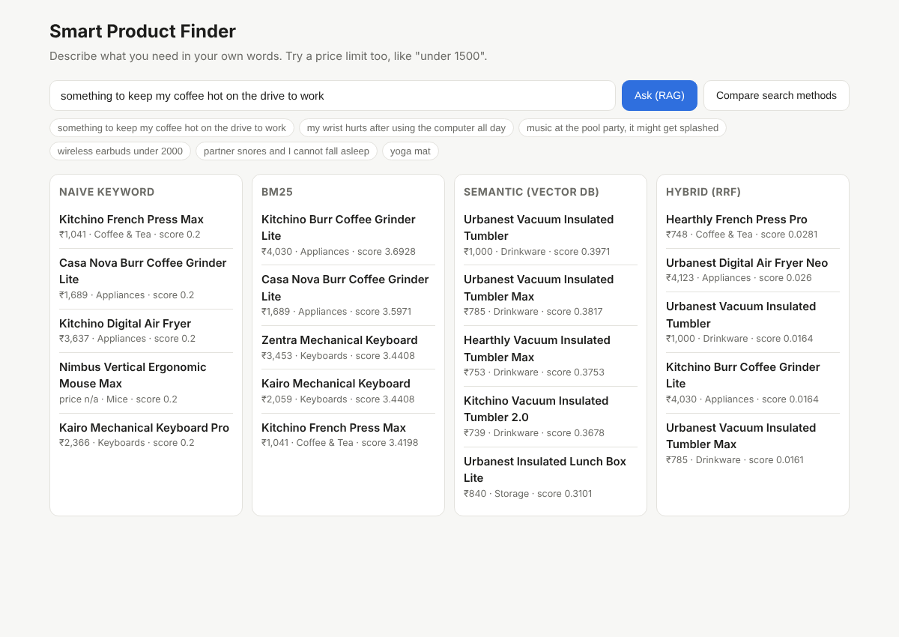

# Smart Product Finder

A RAG (Retrieval-Augmented Generation) product search and recommendation engine.
Type what you need in plain words, like *"something to keep my coffee hot on the drive to work"*,
and it finds the right products from a messy product CSV, even when your words never
appear in the product listing.

**Stack:** Python · LangChain (LCEL) · ChromaDB (HNSW vector index) · MiniLM sentence embeddings (ONNX) · BM25 · FastAPI



*Same query, four methods. Naive keyword and BM25 match the word "coffee" and return coffee grinders. The vector DB understands "keep hot on the drive" means an insulated travel mug.*

## What it does

1. **Parses unstructured CSVs.** The catalog (`data/products_raw.csv`) is deliberately messy: prices like `₹1,299` / `Rs. 1299` / `INR 1,299` / blank, HTML in descriptions, specs as a Flipkart-style `{"key"=>..., "value"=>...}` blob, breadcrumb categories, duplicates and rows with no name. `spf/ingest.py` cleans all of that into LangChain `Document`s and chunks them.
2. **Maps queries to vectors.** Every product and every query is turned into a 384-dimension embedding with `all-MiniLM-L6-v2`.
3. **Indexed semantic search in a vector DB.** Vectors live in a persistent ChromaDB collection with an HNSW index and cosine distance. Price and rating limits in the query ("under 2k", "rated 4+") are pulled out and applied as exact metadata filters inside the vector search.
4. **RAG answer step.** A LangChain LCEL chain retrieves the best products, puts them in a grounded prompt and asks an LLM to recommend from them only. The LLM is pluggable (Anthropic, OpenAI, or free local Ollama), and with no LLM it still returns a ranked answer.
5. **Proves it beats keyword lookup.** `scripts/evaluate.py` runs 40 labelled queries through naive keyword, BM25, semantic and hybrid search and reports Hit@5, MRR, nDCG@5 and P@5.

## Results

From `results/eval_results.md` (179 products, k=5):

| method | Hit@5 (all 40) | MRR (all) | Hit@5 (30 natural-language) | MRR (natural-language) |
|---|---|---|---|---|
| naive keyword | 0.78 | 0.70 | 0.70 | 0.60 |
| BM25 | 0.75 | 0.62 | 0.67 | 0.49 |
| **semantic (vector DB)** | **0.95** | **0.87** | 0.93 | **0.83** |
| hybrid (BM25 + semantic, RRF) | **0.97** | 0.86 | **0.97** | 0.81 |

On plain keyword queries ("yoga mat") every method scores 1.00, so semantic search doesn't lose anything there. The gain is entirely on natural-language queries, where MRR goes from 0.60 to 0.83 (about +38%).

## Quick start

Needs Python 3.10+.

```bash
python -m venv .venv
source .venv/bin/activate          # Windows: .venv\Scripts\activate
pip install -r requirements.txt

python scripts/build_index.py      # clean CSV -> embed -> Chroma (downloads the 80 MB model once)
python scripts/evaluate.py         # keyword vs BM25 vs semantic vs hybrid
python scripts/ask.py "my neck is stiff every morning"
uvicorn app.api:app --reload       # open http://127.0.0.1:8000
pytest -q                          # 15 tests
```

### Turn on an LLM (optional)

Copy `.env.example` to `.env` and pick one:

```bash
# Free and local: install Ollama, run `ollama pull llama3.2`, then
pip install langchain-ollama
SPF_LLM=ollama

# Or Claude
pip install langchain-anthropic
SPF_LLM=anthropic
ANTHROPIC_API_KEY=sk-ant-...

# Or OpenAI
pip install langchain-openai
SPF_LLM=openai
OPENAI_API_KEY=sk-...
```

### Use a real dataset

The cleaner expects Flipkart-style columns (`uniq_id, product_name, product_category_tree, retail_price, discounted_price, brand, description, product_specifications, product_rating`). The public Kaggle dataset *"Flipkart Products"* (`flipkart_com-ecommerce_sample.csv`, 20k products) has exactly these columns:

```bash
python scripts/build_index.py --csv path/to/flipkart_com-ecommerce_sample.csv
# and set SPF_DATA_CSV to the same path so the API/BM25 load it too
```

(The evaluation only works on the sample catalog, because it needs the `type_id` labels.)

## API

| endpoint | what it does |
|---|---|
| `GET /api/search?q=...&mode=semantic&k=5` | retrieval only. `mode` = `keyword`, `bm25`, `semantic`, `hybrid` |
| `GET /api/compare?q=...` | all four methods side by side |
| `POST /api/ask` `{"question": "..."}` | full RAG: retrieve, then LLM answer with sources |
| `GET /api/health` | product count, embedding model, LLM |

Interactive docs at `/docs`.

## Project layout

```
data/
  generate_catalog.py   makes the messy sample CSV (61 product types, 190 rows)
  products_raw.csv      the messy CSV
  eval_queries.json     40 labelled test queries (10 keyword-style, 30 natural-language)
spf/
  config.py             every setting, overridable by env vars
  ingest.py             load -> clean -> Documents -> chunks
  embeddings.py         MiniLM (ONNX) / HuggingFace / OpenAI embeddings
  vectorstore.py        build / load the Chroma collection
  query_parser.py       "under 2k rated 4+" -> metadata filters
  search.py             keyword, BM25, semantic, hybrid (RRF) searchers
  llm.py                pluggable LLM
  rag.py                the LangChain LCEL RAG chain + prompt
  engine.py             loads everything once, used by API/CLI/eval
scripts/                build_index.py, evaluate.py, ask.py
app/                    FastAPI server + single-page UI
tests/                  pytest: cleaning, query parsing, retrieval, RAG chain
results/eval_results.md latest evaluation report
```

## Known limits

- Two natural-language queries still miss in the top 5 (see the bottom of `results/eval_results.md`), for example "read novels outside in bright sun" pulls sunglasses instead of the e-reader. A bigger embedding model or a cross-encoder re-ranker would fix most of these.
- The sample catalog is synthetic, made so the project runs offline. Point it at a real CSV for a larger demo.
- MiniLM is an English model.
